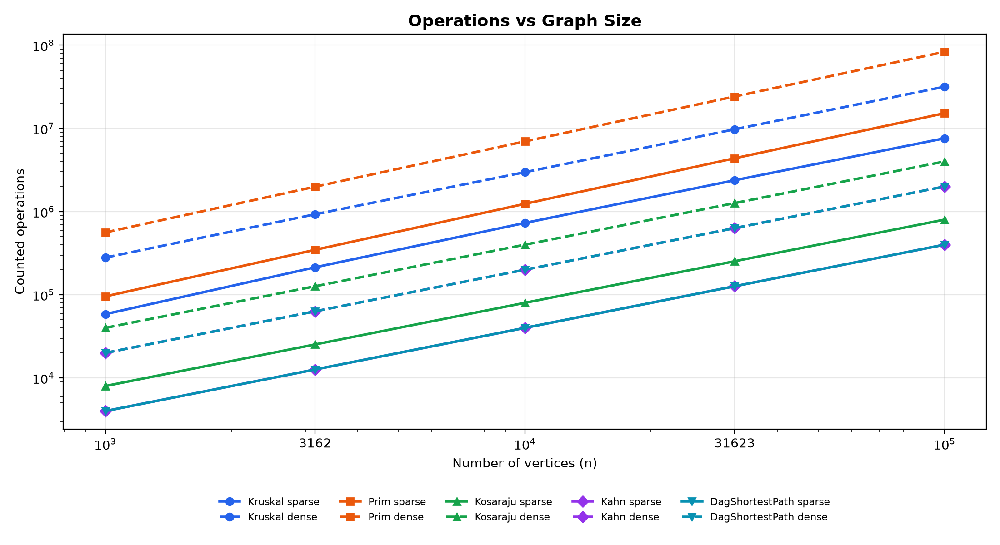
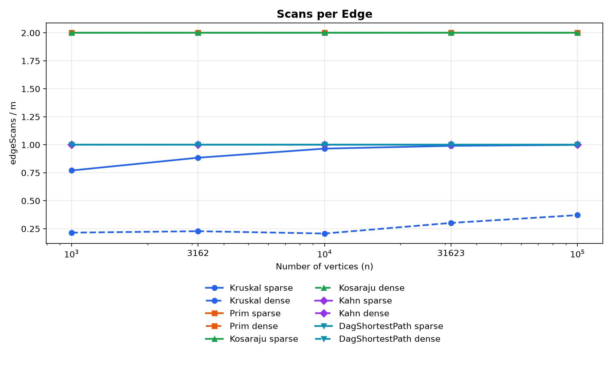
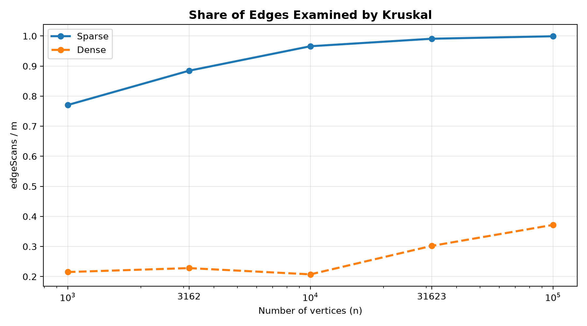

# Assignment 3 – Graph Algorithms

**Course:** Design and Analysis of Algorithms  
**Instructor:** Taubakabyl Nurlybek  
**Student:** Karima Bakhyt  
**Group:** SE-2518

## 1. Complexity Analysis

| Algorithm / Operation | Time Complexity | Extra Space | Justification |
|---|---|---|---|
| DSU find(x) | O(α(V)) amortized | O(V) | Path compression shortens the paths to set representatives. |
| DSU union(x, y) | O(α(V)) amortized | O(V) | Union by rank keeps trees shallow, and find uses path compression. |
| Kruskal | O(E log E + E α(V)) | O(V + E) | Edges are sorted by weight, and DSU prevents cycles. |
| Prim | O(E log E) | O(V + E) | A priority queue selects the cheapest available edge. |
| Kosaraju | O(V + E) | O(V + E) | Two DFS passes visit vertices and scan edges. |
| Kahn | O(V + E) | O(V + E) | In-degrees are calculated, and each vertex and edge is processed once. |
| DAG Shortest Paths | O(V + E) | O(V + E) | A topological order is followed by one relaxation pass. |

Here, V is the number of vertices and E is the number of edges. The function α(V) is the inverse Ackermann function, which grows extremely slowly.

## 2. Benchmark Methodology

The benchmark uses five graph sizes: 1,000, 3,162, 10,000, 31,623 and 100,000 vertices.

Two graph densities are tested:

- Sparse: E = 4V
- Dense: E = 20V

All graphs are generated using `Random(42)`.

The benchmark includes Kruskal, Prim, Kosaraju, Kahn and DAG Shortest Paths.

Each algorithm is executed once for warm-up and then five times for measurement. The median execution time is saved to `results/results.csv`.

The main evidence is the operation counters rather than execution time, because time can depend on the JVM, CPU, cache and background processes.

## 3. Counters vs Complexity Formulas

To check the theoretical complexity, I compared the measured operation counters with the expected formulas.

For Kosaraju, Kahn and DAG Shortest Paths, the number of edge scans grows linearly with the number of edges.

| Algorithm | Formula | Measured Counter | Ratio |
|---|---|---|---|
| Kosaraju | V + E | edgeScans = 2E | 2E / (V + E) |
| Kahn | V + E | edgeScans = E | E / (V + E) |
| DAG Shortest Paths | V + E | edgeScans = E | E / (V + E) |
| Prim | E log E | comparisons | comparisons / (E log2 E) |
| Kruskal | E log E | comparisons | comparisons / (E log2 E) |

For sparse graphs, E = 4V, so the ratio for Kosaraju is 8/5 = 1.6, while the ratios for Kahn and DAG Shortest Paths are 4/5 = 0.8.

For dense graphs, E = 20V, so the ratio for Kosaraju is 40/21 = 1.905, and the ratios for Kahn and DAG Shortest Paths are 20/21 = 0.952.

These ratios remain constant as the number of vertices increases because the graph density stays proportional to V.

### Measured Examples

The results below were taken from `results/results.csv`.

| Algorithm | Graph | V | E | Counter | Ratio |
|---|---|---:|---:|---:|---:|
| Kosaraju | sparse | 1,000 | 4,000 | 8,000 scans | 1.600 |
| Kosaraju | sparse | 100,000 | 400,000 | 800,000 scans | 1.600 |
| Kosaraju | dense | 1,000 | 20,000 | 40,000 scans | 1.905 |
| Kahn | sparse | 1,000 | 4,000 | 4,000 scans | 0.800 |
| Kahn | sparse | 100,000 | 400,000 | 400,000 scans | 0.800 |
| DAG Shortest Paths | dense | 100,000 | 2,000,000 | 2,000,000 scans | 0.952 |

Kruskal also uses DSU operations and edge sorting, so its total work cannot be explained only by edge scans. Its comparisons grow approximately as E log E.

Prim uses a priority queue, and its measured comparisons also grow with E log E.

The operation counters support the expected complexity classes and are more reproducible than execution times.

### Measured Ratios for Kruskal and Prim

The following ratios were calculated directly from `results/results.csv`.

| Algorithm | Graph | n = 1,000 | n = 3,162 | n = 10,000 | n = 31,623 | n = 100,000 |
|---|---|---:|---:|---:|---:|---:|
| Kruskal dsuOps/E | Sparse | 3.190 | 3.660 | 3.996 | 4.096 | 4.125 |
| Kruskal dsuOps/E | Dense | 0.884 | 0.941 | 0.855 | 1.235 | 1.513 |
| Kruskal comparisons/(E log2 E) | Sparse | 0.891 | 0.907 | 0.869 | 0.809 | 0.745 |
| Kruskal comparisons/(E log2 E) | Dense | 0.903 | 0.846 | 0.784 | 0.720 | 0.666 |
| Prim comparisons/(E log2 E) | Sparse | 1.829 | 1.865 | 1.895 | 1.921 | 1.934 |
| Prim comparisons/(E log2 E) | Dense | 1.825 | 1.847 | 1.866 | 1.878 | 1.890 |

The DSU operations per edge for Kruskal remain bounded across the tested sizes.

The sorting comparison ratios for Kruskal stay below 1 and gradually decrease as the graph size grows.

The priority queue comparison ratios for Prim remain close to 2.

These measurements are consistent with the expected logarithmic factors in Kruskal and Prim.

## 4. Slope Check

I used log-log analysis to check how the operation counters grow with the graph size.

A slope close to 1 indicates approximately linear growth.

For Kruskal and Prim, the slope was fitted using the number of weight comparisons. For Kosaraju, Kahn and DAG Shortest Paths, the slope was fitted using edgeScans.

| Algorithm | Sparse Slope | Dense Slope |
|---|---:|---:|
| Kruskal | 1.055 | 1.016 |
| Prim | 1.108 | 1.090 |
| Kosaraju | 1.000 | 1.000 |
| Kahn | 1.000 | 1.000 |
| DAG Shortest Paths | 1.000 | 1.000 |

Kosaraju, Kahn and DAG Shortest Paths have slopes of 1.000 because their edge scans grow linearly with E, and E is proportional to V in both tested densities.

Kruskal has a slightly larger slope because it performs edge sorting, which has O(E log E) complexity.

Prim also has a slope greater than 1 because priority queue operations introduce a logarithmic factor.

The measured slopes support the expected complexity behavior, although the exact fitted values depend on the tested size range and on which operation counter is used.

## 5. Correctness Arguments

### 5.1 Cut Property for Kruskal and Prim

The cut property states that a minimum-weight edge crossing a cut is safe to add to a minimum spanning tree.

A cut divides the vertices into two separate groups.

Kruskal sorts all edges by weight and selects the lightest edge that connects two different components.

DSU helps Kruskal detect whether an edge connects different components or creates a cycle.

Prim starts from one vertex and repeatedly selects the cheapest edge connecting the current tree to an unvisited vertex.

Both algorithms use the cut property to make safe choices without losing the possibility of building a minimum spanning tree.

This explains why Kruskal and Prim can select different edges but still produce the same minimum total weight.

### 5.2 Induction on Topological Order for DAG Shortest Paths

A topological order guarantees that every vertex is processed before its outgoing neighbors.

Initially, every vertex with in-degree zero has distance 0, representing a virtual super-source.

Assume that the shortest distances are correct for all previously processed vertices.

When processing the next vertex, all its predecessors have already been processed because the graph is a DAG.

Therefore, relaxing their outgoing edges has already provided the shortest possible distance to the current vertex.

The algorithm then relaxes the outgoing edges of the current vertex to update the distances of later vertices.

By induction, all shortest distances are correct after the topological order is processed.

Negative weights are allowed because a DAG has no directed cycles, so negative cycles cannot occur.

## 6. Which Algorithm When

Different graph algorithms are useful for different tasks.

| Situation | Algorithm | Reason |
|---|---|---|
| Check whether two vertices are connected through previous unions | DSU | Efficient find and union operations with path compression and union by rank. |
| Find an MST from a weighted edge list | Kruskal | Sorts edges by weight and uses DSU to prevent cycles. |
| Find an MST using an adjacency list | Prim | Grows the tree and selects the cheapest candidate with a priority queue. |
| Find an MST in a disconnected graph | Kruskal or Prim | Both can return a minimum spanning forest. |
| Find strongly connected components in a directed graph | Kosaraju | Uses two DFS passes to identify mutually reachable groups. |
| Find a valid order of dependent jobs | Kahn | Produces a topological order and detects cycles. |
| Find shortest paths in a DAG | DAG Shortest Paths | Processes vertices in topological order in O(V + E). |
| Find shortest paths in a DAG with negative weights | DAG Shortest Paths | Negative weights are safe because the graph has no cycles. |
| Detect a cycle in a directed dependency graph | Kahn | A cycle is detected when fewer than V vertices are processed. |

For sparse graphs, Kruskal is a useful choice when an edge list is available, while Prim is useful when the graph is stored as an adjacency list.

For dense graphs, performance depends on the implementation and the number of priority queue operations.

In this benchmark, Kruskal examined fewer than E edges because it stopped after the spanning tree was completed.

Prim scanned 2E adjacency entries in undirected graphs.

The final choice should depend on graph representation, graph density and the required operation.

## 7. Benchmark Plots

### 7.1 Operations vs Graph Size

This graph shows how the measured operation counts increase as the graph size grows.

Both axes use a logarithmic scale.

Solid lines represent sparse graphs, and dashed lines represent dense graphs.

Prim has a high operation count because its priority queue performs many weight comparisons.

Kruskal also performs sorting comparisons and DSU operations.

Kosaraju, Kahn and DAG Shortest Paths show nearly linear growth in their edge scan counters.

The operation counts are based on the measured counters from the algorithms.

### 7.2 Scans per Edge

This graph shows the ratio edgeScans / E.

Kosaraju has a ratio of 2 because it scans the graph twice.

Prim also has a ratio of 2 because every undirected edge appears in two adjacency lists.

Kahn and DAG Shortest Paths have a ratio of 1 because every edge is processed once.

These flat lines support linear edge traversal behavior.

Kruskal has a smaller ratio because it stops after the minimum spanning tree is completed.

### 7.3 Share of Edges Examined by Kruskal

This graph compares the proportion of examined edges for sparse and dense graphs.

For sparse graphs, Kruskal examines a larger share of the available edges.

As the sparse graph size increases, the examined share approaches 1.

For dense graphs, Kruskal examines a smaller proportion of the edges because many alternative edges are available.

The early stopping condition reduces unnecessary edge examinations after the MST is complete.

However, Kruskal still sorts the entire edge list before processing it, so early stopping does not remove its sorting cost.

## 8. Execution Time Discussion

The benchmark measured execution time as the median of five runs after a warm-up execution. On the largest sparse graph with 100,000 vertices and 400,000 edges, Kruskal took approximately 205 ms and Prim took approximately 356 ms. On the largest dense graph with 100,000 vertices and 2,000,000 edges, Kruskal took approximately 944 ms, while Prim took approximately 2,532 ms. Kosaraju, Kahn and DAG Shortest Paths also required more time as the number of edges increased. The measured execution times are affected by CPU performance, JVM optimizations, memory access and background processes. Therefore, the operation counters are more reliable for confirming asymptotic behavior than execution time alone.
